# План: Бобби Чарльтон — возвращение на вершину — без ведущих

> Сгенерировано `storygro plan` из `ru.reel.yaml`, 2026-11-02. Не правьте этот файл: текст — в спецификации ролика, вопросы и заметки — в `review.yaml`. Затем `storygro plan` заново.

| | |
|---|---|
| Статус | **сценарий** · ждёт тебя: одобрить сценарий |
| Длительность | 87.3 с (по озвучке) · 13 сцен |
| Формат | 1080×1920, 30 fps · style `cartoon` |
| Голос | omnivoice · assets/voice/narrator-ru.wav · 0.9 |
| Серия | football-legends |

## Одобрения

| | | Кто и когда |
|---|---|---|
| Сценарий | ⚙️ техническое (агент) | agent 2026-11-02 |
| Раскадровка | ⚙️ техническое (агент) | agent 2026-11-02 |
| Выпуск | ⏳ ждёт |   |

Одобрить: `storygro approve <spec> --step script|storyboard|release` (агент — с `--agent`).

## Вопросы

- [ ] **owner** · Просмотреть и прослушать отдельную версию без ведущих:чистота удаления персонажей,новые финальные реплики рассказчика,темп. Решение о релизе остаётся за владельцем.

**Заметки:** Explicit owner request2026-11-02:the same film without Sofia and Matvey. No owner storyboard/release approvals recorded;original delivery preserved.

## Хук

- Вариант 1 · **выбран**: «Чарльтон приглашает команду вперёд на поле — выбранное»
- Вариант 2: «Чарльтон с европейским кубком»
- Вариант 3: «Молодой Чарльтон перед дальним ударом»

## Сцены

### 1. hook · 0.0–7.1 с · `series-cover`

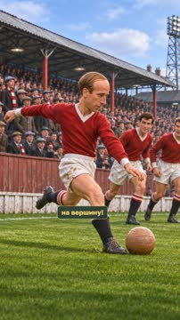

кадр в ключевой момент, затем картинки сцены по порядку

**Голос:** ФУТБОЛЬНЫЕ ЛЕГЕНДЫ! Бобби Чарльтон — человек, который помог «Манчестер Юнайтед» вернуться на вершину!

**Источник озвучки:** `assets/voice/hook.wav`

**Темп реплики:** 1

**На экране:** «Маленькие большие дела» · «Легенды футбола» · «Бобби Чарльтон · сильный удар» · «3.3»

**Факты:** `facts.series.project` = «Маленькие большие дела» · `facts.series.title` = «Легенды футбола» · `facts.series.episode` = «Бобби Чарльтон · сильный удар»

### 2. talent · 7.1–12.1 с · `archive-photo`

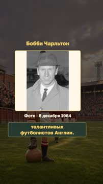

кадр в ключевой момент, затем картинки сцены по порядку

**Голос:** Бобби Чарльтон был одним из самых талантливых футболистов Англии.

**Источник озвучки:** `assets/voice/talent.wav`

**Темп реплики:** 1

**На экране:** «Бобби Чарльтон» · «Фото · 8 декабря 1964» · «contain»

**Факты:** `facts.archive.player` = «Бобби Чарльтон» · `facts.archive.playerDate` = «Фото · 8 декабря 1964»

### 3. strike · 12.1–17.8 с · `illustration`

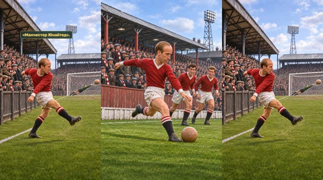

кадр в ключевой момент, затем картинки сцены по порядку

**Голос:** Он прославился мощными ударами издалека и стал настоящей звездой «Манчестер Юнайтед».

**Источник озвучки:** `assets/voice/strike.wav`

**Темп реплики:** 1

**Картинки:**

- shots/strike-setup.png — ok
- `@shot` shots/strike.png — ok

### 4. tragedy · 17.8–28.1 с · `illustration`

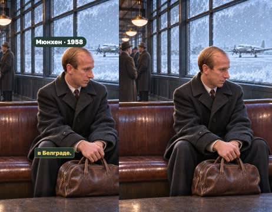

кадр в ключевой момент, затем картинки сцены по порядку

**Голос:** Но в 1958 году случилась страшная трагедия. Самолёт с командой потерпел катастрофу в Мюнхене после матча в Белграде.

**Источник озвучки:** `assets/voice/tragedy.wav`

**Темп реплики:** 1

**На экране:** «Мюнхен · 1958»

**Картинки:**

- shots/airport.png — ok

**Факты:** `facts.history.munich` = «Мюнхен · 1958»

### 5. memory · 28.1–33.3 с · `illustration`

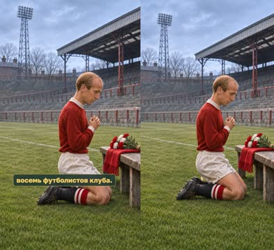

кадр в ключевой момент, затем картинки сцены по порядку

**Голос:** Погибли 23 человека, среди них — восемь футболистов клуба.

**Источник озвучки:** `assets/voice/memory.wav`

**Темп реплики:** 1

**Картинки:**

- shots/memory.png — ok

### 6. return · 33.3–39.1 с · `illustration`

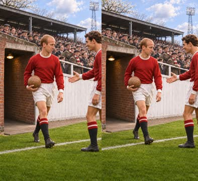

кадр в ключевой момент, затем картинки сцены по порядку

**Голос:** Бобби Чарльтон выжил и спустя несколько недель вернулся на поле.

**Источник озвучки:** `assets/voice/return.wav`

**Темп реплики:** 1

**Картинки:**

- shots/return.png — ok

### 7. rebuild · 39.1–44.4 с · `illustration`

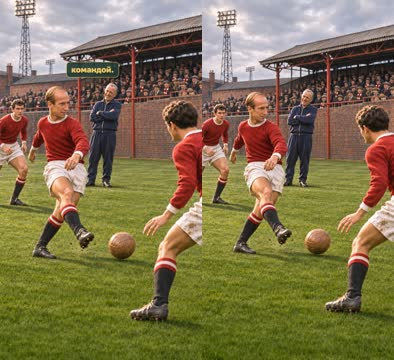

кадр в ключевой момент, затем картинки сцены по порядку

**Голос:** Он помог «Манчестер Юнайтед» восстановиться и снова стать сильной командой.

**Источник озвучки:** `assets/voice/rebuild.wav`

**Темп реплики:** 1

**Картинки:**

- shots/rebuild.png — ok

### 8. world · 44.4–51.4 с · `archive-photo`

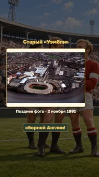

кадр в ключевой момент, затем картинки сцены по порядку

**Голос:** А в 1966 году Чарльтон стал чемпионом мира со сборной Англии!

**Источник озвучки:** `assets/voice/world.wav`

**Темп реплики:** 1

**На экране:** «Старый «Уэмбли»» · «Позднее фото · 2 ноября 1991» · «contain»

**Факты:** `facts.archive.venue` = «Старый «Уэмбли»» · `facts.archive.venueDate` = «Позднее фото · 2 ноября 1991»

### 9. semi · 51.4–60.3 с · `illustration`

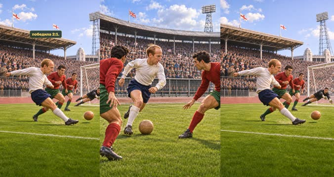

кадр в ключевой момент, затем картинки сцены по порядку

**Голос:** Особенно ярко он сыграл в полуфинале против Португалии: забил оба гола своей команды, которая победила 2:1.

**Источник озвучки:** `assets/voice/semi.wav`

**Темп реплики:** 1

**Картинки:**

- shots/semi-setup.png — ok
- `@goal` shots/semi-goal.png — ok

### 10. award · 60.3–64.4 с · `illustration`

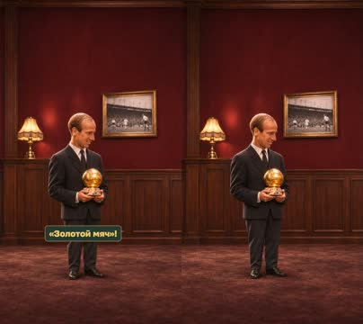

кадр в ключевой момент, затем картинки сцены по порядку

**Голос:** В том же году Бобби получил «Золотой мяч»!

**Источник озвучки:** `assets/voice/award.wav`

**Темп реплики:** 1

**Картинки:**

- shots/award-safe.png — ok

**На слух:** Золотой — верно (дубль 1)

### 11. europe · 64.4–73.8 с · `illustration`

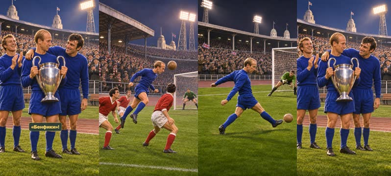

кадр в ключевой момент, затем картинки сцены по порядку

**Голос:** А через два года он помог «Манчестер Юнайтед» выиграть Кубок европейских чемпионов, забив два гола в финале против «Бенфики»!

**Источник озвучки:** `assets/voice/europe.wav`

**Темп реплики:** 1

**Картинки:**

- shots/europe-header.png — ok
- `@second` shots/europe-finish.png — ok
- `@cup` shots/cup.png — ok

### 12. takeaway · 73.8–79.5 с · `illustration`

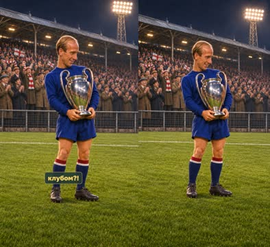

кадр в ключевой момент, затем картинки сцены по порядку

**Голос:** Получается, он стал чемпионом мира, а потом ещё и чемпионом Европы с клубом?!

**Источник озвучки:** `assets/voice/takeaway.wav`

**Темп реплики:** 1

**Картинки:**

- shots/matvey.png — ok

### 13. conclusion · 79.5–87.3 с · `illustration`

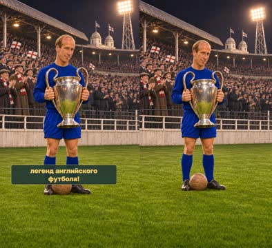

кадр в ключевой момент, затем картинки сцены по порядку

**Голос:** Именно! Бобби Чарльтон вошёл в историю как одна из величайших легенд английского футбола!

**Источник озвучки:** `assets/voice/conclusion.wav`

**Темп реплики:** 1

**Картинки:**

- shots/sofia-blue.png — ok

## Факты и источники

| | |
|---|---|
| `facts.series` | Owner rubric/script2026-11-02;strong shot is an editorial trait, not nickname |
| `facts.archive` | photos.json:P1,P2 |
| `facts.history` | sources.md:S1,S2,S3 |
| `facts.match` | sources.md:S2,S3,S4 |

→ [sources.md](sources.md)

## Текст поста

> Маленькие большие дела · Легенды футбола. smart_little_toons. Версия без ведущих.
>
> История Бобби Чарльтона: талант, мюнхенская трагедия1958 года, возвращение на поле и восстановление команды, чемпионство мира и «Золотой мяч»1966, Кубок европейских чемпионов1968. Все слова истории сохранены;имена ролей убраны,заключительные реплики произносит рассказчик. Источники: Manchester United, England Football, UEFA, DFB; ссылки в sources.md.
>
> Иллюстрации созданы встроенным image_gen, это художественная постановка истории с движением камеры и последовательными состояниями действий. Не документальные кадры матчей. Голос рассказчика синтетический: OmniVoice B.
>
> Фото Чарльтона: Jack de Nijs / Anefo / Nationaal Archief,08.12.1964, https://commons.wikimedia.org/wiki/File:Bobby_Charlton_Aankomst_Engelse_voetbalelftal_op_Schiphol,_Bestanddeelnr_917-2187_(cropped).jpg ; текущая лицензия CC0 https://creativecommons.org/publicdomain/zero/1.0/ . Показан существующий архивный портретный crop целиком, без ретуши.
>
> Фото Wembley: Adrian Cable,02.11.1991, https://commons.wikimedia.org/wiki/File:The_old_Wembley_Stadium.jpg ; CC BY-SA2.0 https://creativecommons.org/licenses/by-sa/2.0/ . Снимок показан целиком без ретуши; поздняя фотография стадиона не изображает матч1966/1968. Фото сохраняет собственную лицензию, остальные материалы имеют отдельные условия.
