# План: Петр Чех — футбольный вратарь, который стал хоккейным голкипером!

> Сгенерировано `storygro plan` из `ru.reel.yaml`, 2026-11-01. Не правьте этот файл: текст — в спецификации ролика, вопросы и заметки — в `review.yaml`. Затем `storygro plan` заново.

| | |
|---|---|
| Статус | **сценарий** · ждёт тебя: одобрить сценарий |
| Длительность | 91.7 с (по озвучке) · 12 сцен |
| Формат | 1080×1920, 30 fps · style `cartoon` |
| Голос | omnivoice · assets/voice/narrator-ru.wav · 0.96 |
| Серия | football-wow |

## Одобрения

| | | Кто и когда |
|---|---|---|
| Сценарий | ⚙️ техническое (агент) | agent 2026-11-01 |
| Раскадровка | ⚙️ техническое (агент) | agent 2026-11-01 |
| Выпуск | ⏳ ждёт |   |

Одобрить: `storygro approve <spec> --step script|storyboard|release` (агент — с `--agent`).

## Вопросы

- [ ] **owner** · Посмотреть весь ролик:сходство Чеха,рисунки,темп,ударения и новые реплики выбранными голосами. Решение о релизе за владельцем.

**Заметки:** Owner commissioned complete verbatim film2026-11-01. Owner authorised removal ONLY of source artifact Cech stars on hockey debut+2. Production/render for review authorised; no publication or owner approvals recorded.

## Хук

- Вариант 1 · **выбран**: «Чех меняет футбольные ворота на хоккейные — выбранный визуальный переход»
- Вариант 2: «Вратарь с шайбой: неожиданное продолжение карьеры»
- Вариант 3: «Два вида снаряжения перед выбором»

## Сцены

### 1. hook · 0.0–6.0 с · `series-cover`

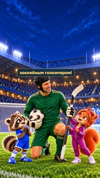

кадр в ключевой момент, затем картинки сцены по порядку

**Голос:** ФУТБОЛЬНЫЙ ВАУ-ФАКТ! Петр Чех — футбольный вратарь, который стал хоккейным голкипером!

**Источник озвучки:** `assets/voice/hook.wav`

**Темп реплики:** 1

**На экране:** «Маленькие большие дела» · «ФУТБОЛЬНЫЙ ВАУ-ФАКТ!» · «Петр Чех · с поля на лёд» · «3.2»

> ⚠️ Ударение не проверено: ВАУ-ФАКТ — найти и добавить в словарь: `storygro stress <spec> --lookup --write`

**Факты:** `facts.series.project` = «Маленькие большие дела» · `facts.series.title` = «ФУТБОЛЬНЫЙ ВАУ-ФАКТ!» · `facts.series.episode` = «Петр Чех · с поля на лёд»

### 2. imagine-football · 6.0–14.8 с · `illustration`

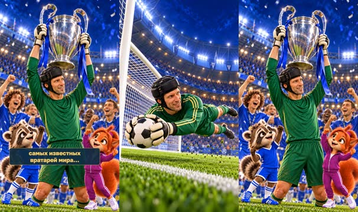

кадр в ключевой момент, затем картинки сцены по порядку

**Голос:** Представь: ты много лет защищаешь футбольные ворота, выигрываешь Лигу чемпионов, становишься одним из самых известных вратарей мира…

**Источник озвучки:** `assets/voice/imagine-football.wav`

**Темп реплики:** 1

**Картинки:**

- shots/football-save.png — ok
- `@cup` shots/trophy.png — ok

### 3. imagine-hockey · 14.8–22.2 с · `illustration`

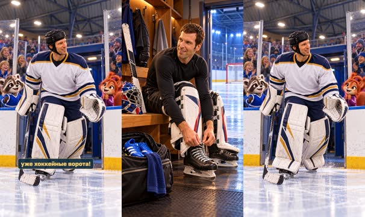

кадр в ключевой момент, затем картинки сцены по порядку

**Голос:** А после завершения футбольной карьеры надеваешь коньки, берёшь клюшку и выходишь защищать уже хоккейные ворота!

**Источник озвучки:** `assets/voice/imagine-hockey.wav`

**Темп реплики:** 1

**Картинки:**

- shots/skates.png — ok
- `@ice` shots/rink-entry.png — ok

### 4. portrait · 22.2–28.4 с · `archive-photo`

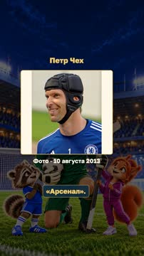

кадр в ключевой момент, затем картинки сцены по порядку

**Голос:** Именно так поступил Петр Чех — знаменитый чешский вратарь, который играл за «Челси» и «Арсенал».

**Источник озвучки:** `assets/voice/portrait.wav`

**Темп реплики:** 1

**На экране:** «Петр Чех» · «Фото · 10 августа 2013» · «contain»

**Факты:** `facts.archive.playerTitle` = «Петр Чех» · `facts.archive.playerDate` = «Фото · 10 августа 2013»

### 5. childhood · 28.4–40.1 с · `illustration`

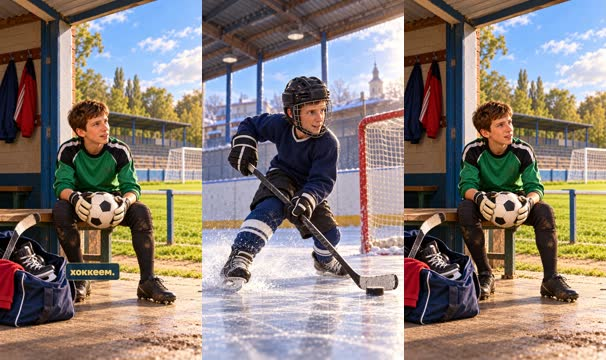

кадр в ключевой момент, затем картинки сцены по порядку

**Голос:** Но самое интересное: хоккей не был для него совершенно новым увлечением. В детстве Петр тоже занимался хоккеем, но в 13 лет ему пришлось выбирать между футболом и хоккеем.

**Источник озвучки:** `assets/voice/childhood.wav`

**Темп реплики:** 1

**Картинки:**

- shots/childhood.png — ok
- `@choice` shots/choice-young.png — ok

### 6. choice · 40.1–44.1 с · `illustration`

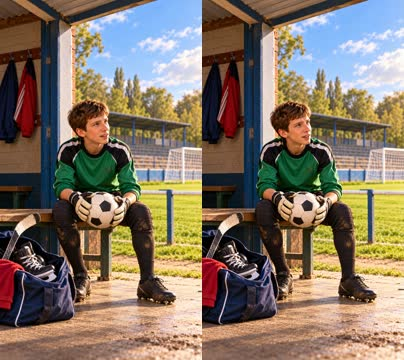

кадр в ключевой момент, затем картинки сцены по порядку

**Голос:** Он выбрал футбол, хотя любовь ко льду никуда не исчезла.

**Источник озвучки:** `assets/voice/choice.wav`

**Темп реплики:** 1

**Картинки:**

- shots/choice-young.png — ok

### 7. return · 44.1–52.0 с · `illustration`

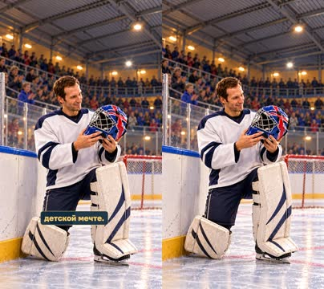

кадр в ключевой момент, затем картинки сцены по порядку

**Голос:** В 2019 году, завершив профессиональную футбольную карьеру, Чех наконец вернулся к своей детской мечте.

**Источник озвучки:** `assets/voice/return.wav`

**Темп реплики:** 1

**Картинки:**

- shots/return-safe.png — ok

### 8. phoenix · 52.0–58.0 с · `illustration`

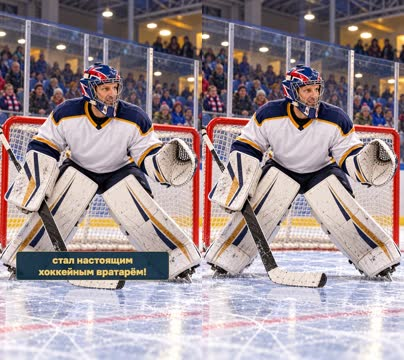

кадр в ключевой момент, затем картинки сцены по порядку

**Голос:** Он подписал контракт с хоккейной командой Guildford Phoenix и стал настоящим хоккейным вратарём!

**Источник озвучки:** `assets/voice/phoenix.wav`

**Темп реплики:** 1

**Картинки:**

- shots/phoenix.png — ok

### 9. debut · 58.0–68.7 с · `illustration`

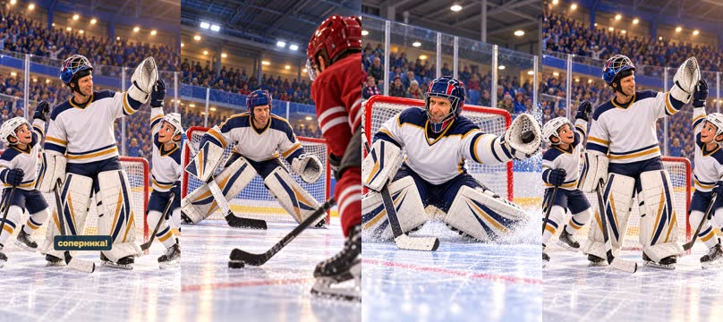

кадр в ключевой момент, затем картинки сцены по порядку

**Голос:** А знаешь, что ещё удивительнее? В своём первом официальном хоккейном матче он помог команде победить в серии буллитов, отразив решающий бросок соперника!

**Источник озвучки:** `assets/voice/debut.wav`

**Темп реплики:** 1

**Картинки:**

- shots/shootout.png — ok
- `@save` shots/hockey-save-correct.png — ok
- `@win` shots/hockey-win.png — ok

### 10. huskies · 68.7–77.5 с · `illustration`

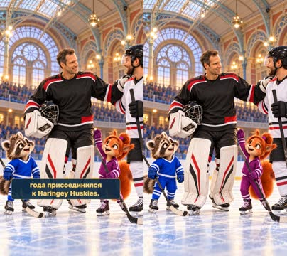

кадр в ключевой момент, затем картинки сцены по порядку

**Голос:** Позже Петр играл за другие английские хоккейные клубы, а в ноябре 2025 года присоединился к Haringey Huskies.

**Источник озвучки:** `assets/voice/huskies.wav`

**Темп реплики:** 1

**Картинки:**

- shots/huskies-correct.png — ok

> ⚠️ Ударение не проверено: Харингей — найти и добавить в словарь: `storygro stress <spec> --lookup --write`

### 11. matvey · 77.5–82.9 с · `illustration`

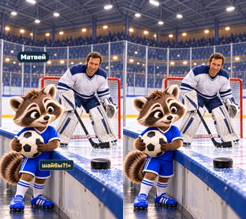

кадр в ключевой момент, затем картинки сцены по порядку

**Голос:** Матвей: «Подожди! Он сначала ловил мячи руками, а теперь ловит шайбы?!»

**Источник озвучки:** `assets/voice/matvey.wav`

**Темп реплики:** 1

**На экране:** «Матвей»

**Картинки:**

- shots/matvey-safe.png — ok

**Факты:** `facts.cast.matvey` = «Матвей»

### 12. sofia · 82.9–91.7 с · `illustration`

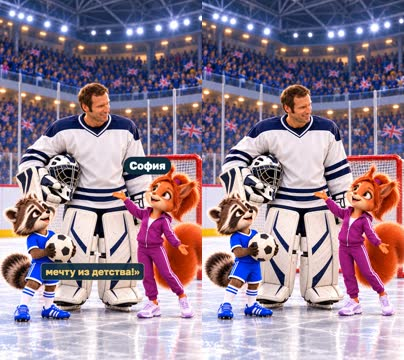

кадр в ключевой момент, затем картинки сцены по порядку

**Голос:** София: «Именно! Петр Чех доказал, что даже после завершения одной спортивной карьеры можно осуществить мечту из детства!»

**Источник озвучки:** `assets/voice/sofia.wav`

**Темп реплики:** 1

**На экране:** «София»

**Картинки:**

- shots/sofia-safe.png — ok

**Факты:** `facts.cast.sofia` = «София»

## Факты и источники

| | |
|---|---|
| `facts.series` | Owner brief2026-11-01; sources.md |
| `facts.archive` | photos.json |
| `facts.cast` | ../../series/football-legends/cast/cast.json |
| `facts.story` | sources.md |

→ [sources.md](sources.md)

## Текст поста

> Маленькие большие дела · ФУТБОЛЬНЫЙ ВАУ-ФАКТ! София и Матвей, smart_little_toons.
>
> Петр Чех: футбольный вратарь и хоккейный голкипер. Источники: Chelsea FC (09.10.2019), IIHF (14.10.2019), Haringey Huskies (27.11.2025).
>
> Фото: Petr Čech Chelsea2013, Warrenfish,10.08.2013; кадрирование Heiko Gerber,20.10.2020,CC BY-SA3.0, https://commons.wikimedia.org/wiki/File:Petr_%C4%8Cech_Chelsea_2013.jpg ; https://creativecommons.org/licenses/by-sa/3.0/ . Фото показано целиком,без новой обрезки или ретуши. Это фото2013,не хоккейного дебюта2019.
>
> Подробные иллюстрации созданы встроенным image_gen (точный ID модели не раскрыт); действия — художественная интерпретация. Голоса синтетические: рассказчик OmniVoice B, ведущие Qwen3-TTS по выбранным эталонам Матвей C и София A.
