# План: Харри Кейн — нападающий, который стал вратарём!

> Сгенерировано `storygro plan` из `ru.reel.yaml`, 2026-11-01. Не правьте этот файл: текст — в спецификации ролика, вопросы и заметки — в `review.yaml`. Затем `storygro plan` заново.

| | |
|---|---|
| Статус | **сценарий** · ждёт тебя: одобрить сценарий |
| Длительность | 79.5 с (по озвучке) · 12 сцен |
| Формат | 1080×1920, 30 fps · style `cartoon` |
| Голос | omnivoice · assets/voice/narrator-ru.wav · 0.82 |
| Серия | football-wow |

## Одобрения

| | | Кто и когда |
|---|---|---|
| Сценарий | ⚙️ техническое (агент) | agent 2026-11-01 |
| Раскадровка | ⚙️ техническое (агент) | agent 2026-11-01 |
| Выпуск | ⏳ ждёт |   |

Одобрить: `storygro approve <spec> --step script|storyboard|release` (агент — с `--agent`).

## Вопросы

- [ ] **owner** · Посмотреть собранный ролик: сходство Кейна, рисунки, речь и ударения, темп, реплики Софии и Матвея. Одобрение релиза остаётся за владельцем.

**Заметки:** Owner commissioned full verbatim text and production on 2026-11-01. Local preview/render authorised by this request; no publication requested. Agent approvals record technical checks only; owner viewing/listening and release approval pending.

## Хук

- Вариант 1 · **выбран**: «Кейн получает перчатки после хет-трика (выбрано; текст исходный)»
- Вариант 2: «Один футболист — две роли (визуальная альтернатива)»
- Вариант 3: «Кто защитит пустые ворота? (визуальная альтернатива)»

## Сцены

### 1. hook · 0.0–5.8 с · `series-cover`

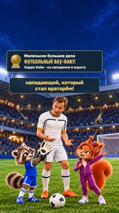

кадр в ключевой момент, затем картинки сцены по порядку

**Голос:** ФУТБОЛЬНЫЙ ВАУ-ФАКТ! Харри Кейн — нападающий, который стал вратарём!

**Источник озвучки:** `assets/voice/kane-v2/hook.wav`

**Темп реплики:** 1

**На экране:** «Маленькие большие дела» · «ФУТБОЛЬНЫЙ ВАУ-ФАКТ!» · «Харри Кейн · из нападения в ворота»

> ⚠️ Ударение не проверено: ВАУ-ФАКТ — найти и добавить в словарь: `storygro stress <spec> --lookup --write`

**Факты:** `facts.series.project` = «Маленькие большие дела» · `facts.series.title` = «ФУТБОЛЬНЫЙ ВАУ-ФАКТ!» · `facts.series.episode` = «Харри Кейн · из нападения в ворота»

### 2. imagine · 5.8–14.0 с · `illustration`

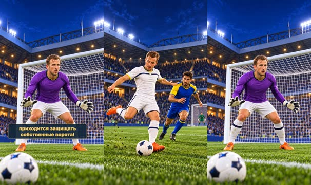

кадр в ключевой момент, затем картинки сцены по порядку

**Голос:** Представь: ты забиваешь три гола за один матч, а через несколько минут тебе приходится защищать собственные ворота!

**Источник озвучки:** `assets/voice/kane-v2/imagine.wav`

**Темп реплики:** 1

**Картинки:**

- shots/strike-fixed.png — ok
- `@change` shots/keeper.png — ok

### 3. context · 14.0–20.4 с · `archive-photo`

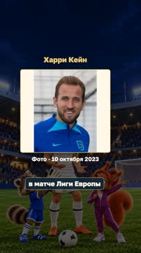

кадр в ключевой момент, затем картинки сцены по порядку

**Голос:** Именно это случилось с Харри Кейном 23 октября 2014 года

**Источник озвучки:** `assets/voice/kane-v2/context.wav`

**Темп реплики:** 1

**На экране:** «Харри Кейн» · «Фото · 10 октября 2023» · «contain»

**Факты:** `facts.archive.playerTitle` = «Харри Кейн» · `facts.archive.playerDate` = «Фото · 10 октября 2023»

### 4. venue · 20.4–26.2 с · `photo-pair`

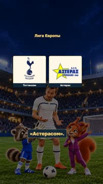

кадр в ключевой момент, затем картинки сцены по порядку

**Голос:** в матче Лиги Европы между «Тоттенхэмом» и греческим «Астерасом».

**Источник озвучки:** `assets/voice/kane-v2/venue.wav`

**Темп реплики:** 1

**На экране:** «Лига Европы» · «Тоттенхэм» · «contain» · «Астерас»

> ⚠️ Ударение не проверено: Лиги — найти и добавить в словарь: `storygro stress <spec> --lookup --write`

**Факты:** `facts.teams.heading` = «Лига Европы» · `facts.teams.home` = «Тоттенхэм» · `facts.teams.away` = «Астерас»

### 5. hat-trick · 26.2–34.9 с · `illustration`

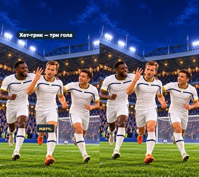

кадр в ключевой момент, затем картинки сцены по порядку

**Голос:** «Тоттенхэм» уверенно вёл со счётом 5:0, а Кейн уже оформил хет-трик — забил три мяча за матч.

**Источник озвучки:** `assets/voice/kane-v2/hat-trick.wav`

**Темп реплики:** 1

**На экране:** «5:0» · «Хет-трик — три гола»

**Картинки:**

- shots/celebrate.png — ok

**Факты:** `facts.match.before` = «5:0» · `facts.match.hattrick` = «Хет-трик — три гола»

### 6. red-card · 34.9–44.3 с · `illustration`

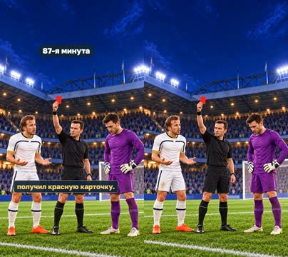

кадр в ключевой момент, затем картинки сцены по порядку

**Голос:** Но на 87-й минуте произошло неожиданное: вратарь «Тоттенхэма» Уго Льорис получил красную карточку.

**Источник озвучки:** `assets/voice/kane-v3/red-card.wav`

**Темп реплики:** 1

**На экране:** «87-я минута»

**Картинки:**

- shots/red-card.png — ok

**Факты:** `facts.match.minute` = «87-я минута»

### 7. bench · 44.3–49.7 с · `illustration`

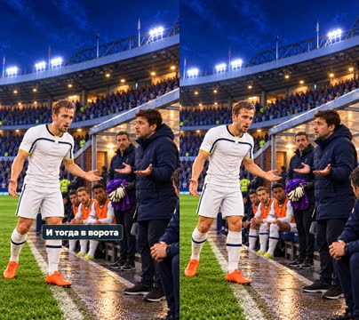

кадр в ключевой момент, затем картинки сцены по порядку

**Голос:** Все замены команда уже использовала, поэтому заменить его было некем.

**Источник озвучки:** `assets/voice/kane-v2/bench.wav`

**Темп реплики:** 1

**Картинки:**

- shots/bench.png — ok

### 8. volunteer · 49.7–53.8 с · `illustration`

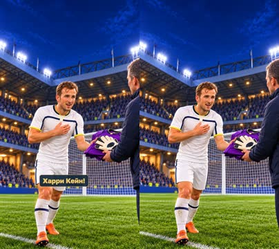

кадр в ключевой момент, затем картинки сцены по порядку

**Голос:** И тогда в ворота встал... Харри Кейн!

**Источник озвучки:** `assets/voice/kane-v2/volunteer.wav`

**Темп реплики:** 1

**Картинки:**

- shots/volunteer.png — ok

### 9. gloves · 53.8–64.7 с · `illustration`

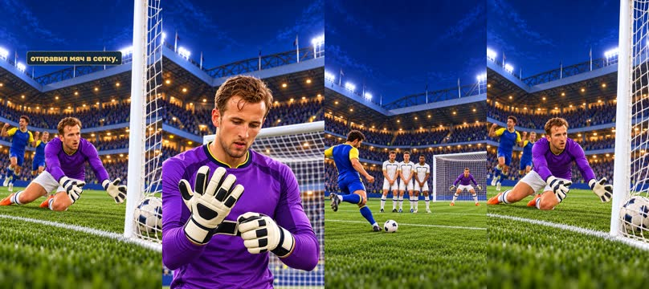

кадр в ключевой момент, затем картинки сцены по порядку

**Голос:** Он надел вратарскую форму и перчатки, но долго постоять на ноль не получилось: после штрафного удара соперник отправил мяч в сетку.

**Источник озвучки:** `assets/voice/kane-v2/gloves.wav`

**Темп реплики:** 1

**Картинки:**

- shots/gloves.png — ok
- `@kick` shots/free-kick.png — ok
- `@net` shots/concede.png — ok

### 10. result · 64.7–69.4 с · `illustration`

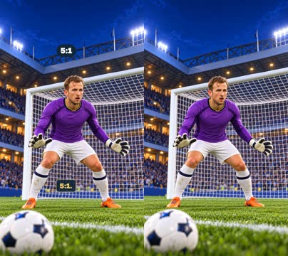

кадр в ключевой момент, затем картинки сцены по порядку

**Голос:** Матч закончился со счётом 5:1.

**Источник озвучки:** `assets/voice/kane-v2/result.wav`

**Темп реплики:** 1

**На экране:** «5:1»

**Картинки:**

- shots/keeper.png — ok

**Факты:** `facts.match.final` = «5:1»

### 11. matvey · 69.4–75.4 с · `illustration`

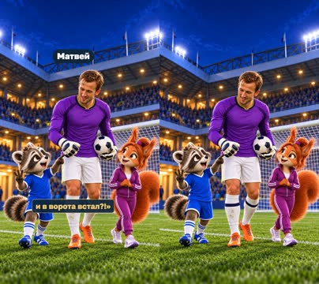

кадр в ключевой момент, затем картинки сцены по порядку

**Голос:** Матвей: «Подожди! Он сначала забил три гола, а потом ещё и в ворота встал?!»

**Источник озвучки:** `assets/voice/matvey-C-reply.wav`

**Темп реплики:** 1

**На экране:** «Матвей»

**Картинки:**

- shots/matvey.png — ok

**Факты:** `facts.cast.matvey` = «Матвей»

### 12. sofia · 75.4–79.5 с · `illustration`

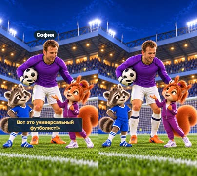

кадр в ключевой момент, затем картинки сцены по порядку

**Голос:** София: «Да! Вот это универсальный футболист!»

**Источник озвучки:** `assets/voice/sofia-A-reply.wav`

**Темп реплики:** 1

**На экране:** «София»

**Картинки:**

- shots/sofia.png — ok

**Факты:** `facts.cast.sofia` = «София»

## Факты и источники

| | |
|---|---|
| `facts.series` | — |
| `facts.match` | sources.md#match |
| `facts.archive` | photos.json |
| `facts.cast` | Approved fictional cast and owner voice selection, 2026-11-01; assets/voice/host-voices.json |
| `facts.teams` | sources.md#match |

→ [sources.md](sources.md)

## Текст поста

> Харри Кейн забил три гола, а затем встал в ворота: «Тоттенхэм» — «Астерас», 23 октября 2014, 5:1. Источник: Tottenham Hotspur, официальный отчёт о матче.
>
> Маленькие большие дела · ФУТБОЛЬНЫЙ ВАУ-ФАКТ! София и Матвей, smart_little_toons. Голоса синтетические: рассказчик — OmniVoice B, Матвей C и София A — Qwen3-TTS; иллюстрации созданы встроенным GPT Image, действия — художественная интерпретация.
>
> Фото: Harry Kane 2023 (cropped) — Simon Walker / No 10 Downing Street, UK Prime Minister, 10.10.2023, CC BY 2.0, https://commons.wikimedia.org/wiki/File:Harry_Kane_2023_(cropped).jpg ; https://creativecommons.org/licenses/by/2.0/. Опубликованное кадрирование Stanley Gordon, без дополнительной ретуши или обрезки. Это портрет 2023 года, не фото матча 2014 года. Гербы Tottenham Hotspur и Asteras Tripolis показаны для обозначения участников матча; принадлежат соответствующим клубам. Источники: https://en.wikipedia.org/wiki/File:Tottenham_Hotspur.svg ; https://commons.wikimedia.org/wiki/File:Asteras_Tripolis_Logo.svg .
