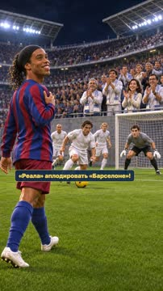
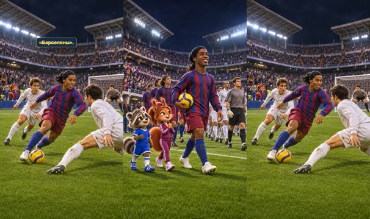
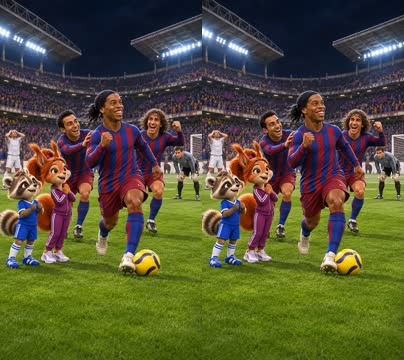
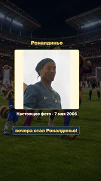
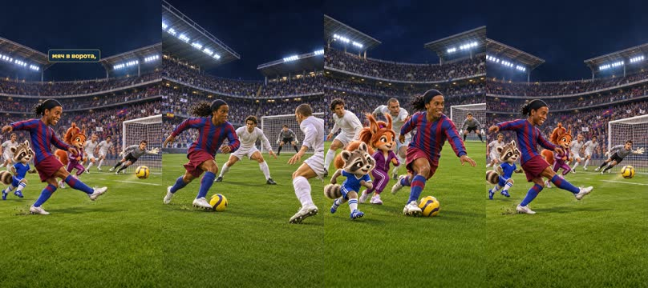
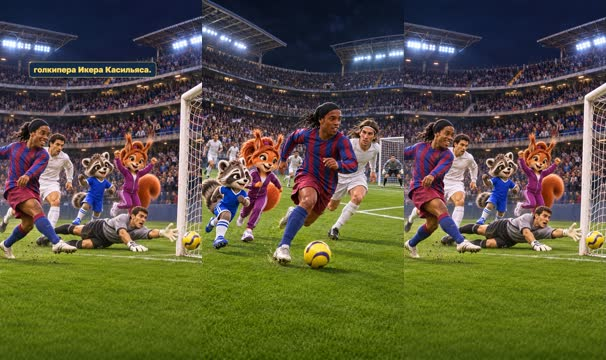
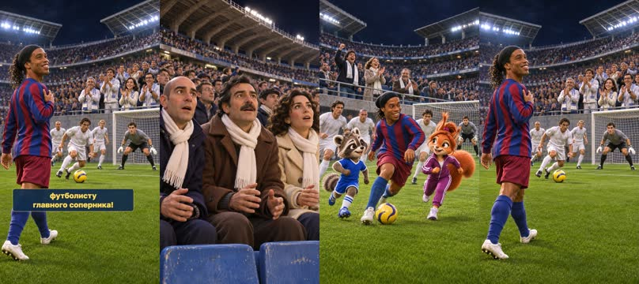
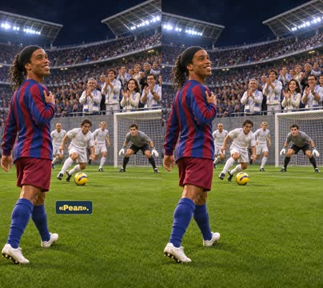
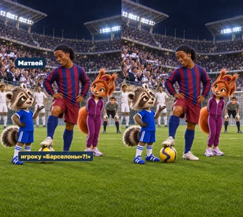
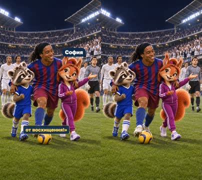

# План: Роналдиньо — овация болельщиков «Реала»

> Сгенерировано `storygro plan` из `ru.reel.yaml`, 2026-11-02. Не правьте этот файл: текст — в спецификации ролика, вопросы и заметки — в `review.yaml`. Затем `storygro plan` заново.

| | |
|---|---|
| Статус | **сценарий** · ждёт тебя: одобрить сценарий |
| Длительность | 69.4 с (по озвучке) · 10 сцен |
| Формат | 1080×1920, 30 fps · style `cartoon` |
| Голос | omnivoice · assets/voice/narrator-ru.wav · 0.9 |
| Серия | football-wow |

## Одобрения

| | | Кто и когда |
|---|---|---|
| Сценарий | ⚙️ техническое (агент) | agent 2026-11-02 |
| Раскадровка | ⚙️ техническое (агент) | agent 2026-11-02 |
| Выпуск | ⏳ ждёт |   |

Одобрить: `storygro approve <spec> --step script|storyboard|release` (агент — с `--agent`).

## Вопросы

- [ ] **owner** · Просмотреть и прослушать полный фильм:сходство Роналдиньо,связность голов,темп,ударения,голоса. Решение о релизе остаётся за владельцем.

**Заметки:** Full new film commissioned by supplied script2026-11-02. All text retained. No owner storyboard/release approvals or publication inferred.

## Хук

- Вариант 1 · **выбран**: «Роналдиньо с мячом, белые шарфы соперников и аплодисменты — выбранное»
- Вариант 2: «Два защитника закрывают путь Роналдиньо»
- Вариант 3: «Болельщик в белом начинает аплодировать»

## Сцены

### 1. hook · 0.0–6.5 с · `series-cover`

кадр в ключевой момент, затем картинки сцены по порядку

**Голос:** ФУТБОЛЬНЫЙ ВАУ-ФАКТ! Роналдиньо заставил болельщиков «Реала» аплодировать «Барселоне»!

**Источник озвучки:** `assets/voice/hook.wav`

**Темп реплики:** 1

**На экране:** «Маленькие большие дела» · «ФУТБОЛЬНЫЙ ВАУ-ФАКТ!» · «Роналдиньо · овация соперников» · «3.2»

> ⚠️ Ударение не проверено: ВАУ-ФАКТ — найти и добавить в словарь: `storygro stress <spec> --lookup --write`

**Факты:** `facts.series.project` = «Маленькие большие дела» · `facts.series.title` = «ФУТБОЛЬНЫЙ ВАУ-ФАКТ!» · `facts.series.episode` = «Роналдиньо · овация соперников»

### 2. arena · 6.5–19.2 с · `illustration`

кадр в ключевой момент, затем картинки сцены по порядку

**Голос:** 19 ноября 2005 года на стадионе «Сантьяго Бернабеу» в Мадриде состоялось одно из самых знаменитых противостояний футбола — «Реал Мадрид» против «Барселоны».

**Источник озвучки:** `assets/voice/arena.wav`

**Темп реплики:** 1

**Картинки:**

- shots/arena-wide.png — ok
- `@clash` shots/faceoff.png — ok

### 3. result · 19.2–23.3 с · `illustration`

кадр в ключевой момент, затем картинки сцены по порядку

**Голос:** «Барселона» победила со счётом 3:0.

**Источник озвучки:** `assets/voice/result.wav`

**Темп реплики:** 1

**Картинки:**

- shots/celebrate.png — ok

### 4. hero · 23.3–27.7 с · `archive-photo`

кадр в ключевой момент, затем картинки сцены по порядку

**Голос:** Но настоящим героем вечера стал Роналдиньо!

**Источник озвучки:** `assets/voice/hero.wav`

**Темп реплики:** 1

**На экране:** «Роналдиньо» · «Настоящее фото · 7 мая 2006» · «contain»

**Факты:** `facts.archive.title` = «Роналдиньо» · `facts.archive.date` = «Настоящее фото · 7 мая 2006»

### 5. first · 27.7–35.0 с · `illustration`

кадр в ключевой момент, затем картинки сцены по порядку

**Голос:** Бразилец забил два невероятных гола: сначала обыграл нескольких защитников и отправил мяч в ворота,

**Источник озвучки:** `assets/voice/first.wav`

**Темп реплики:** 1

**Картинки:**

- shots/first-approach.png — ok
- `@beat` shots/first-beat.png — ok
- `@shot` shots/first-shot.png — ok

### 6. second · 35.0–41.6 с · `illustration`

кадр в ключевой момент, затем картинки сцены по порядку

**Голос:** а затем снова прорвался по левому флангу и обманул голкипера Икера Касильяса.

**Источник озвучки:** `assets/voice/second.wav`

**Темп реплики:** 1

**Картинки:**

- shots/second-run.png — ok
- `@finish` shots/second-finish.png — ok

### 7. standing · 41.6–49.6 с · `illustration`

кадр в ключевой момент, затем картинки сцены по порядку

**Голос:** И вот случилось невероятное: болельщики «Реала» начали вставать со своих мест и аплодировать футболисту главного соперника!

**Источник озвучки:** `assets/voice/standing.wav`

**Темп реплики:** 1

**Картинки:**

- shots/fans-seated-v2.png — ok
- `@rise` shots/fans-rise.png — ok
- `@clap` shots/applause.png — ok

### 8. ovation · 49.6–55.9 с · `illustration`

кадр в ключевой момент, затем картинки сцены по порядку

**Голос:** Роналдиньо получил овацию на стадионе, где обычно поддерживают только «Реал».

**Источник озвучки:** `assets/voice/ovation.wav`

**Темп реплики:** 1

**Картинки:**

- shots/applause.png — ok

### 9. matvey · 55.9–61.4 с · `illustration`

кадр в ключевой момент, затем картинки сцены по порядку

**Голос:** Матвей: «Подожди! Болельщики «Реала» аплодировали игроку «Барселоны»?!»

**Источник озвучки:** `assets/voice/matvey.wav`

**Темп реплики:** 1

**На экране:** «Матвей»

**Картинки:**

- shots/matvey.png — ok

**Факты:** `facts.cast.matvey` = «Матвей»

### 10. sofia · 61.4–69.4 с · `illustration`

кадр в ключевой момент, затем картинки сцены по порядку

**Голос:** София: «Да! Когда футбол настолько красивый, даже соперники не могут удержаться от восхищения!»

**Источник озвучки:** `assets/voice/sofia.wav`

**Темп реплики:** 1

**На экране:** «София»

**Картинки:**

- shots/sofia.png — ok

**Факты:** `facts.cast.sofia` = «София»

## Факты и источники

| | |
|---|---|
| `facts.series` | Owner script2026-11-02;editorial description,not nickname |
| `facts.archive` | photos.json:P1,Darz Mol |
| `facts.cast` | ../../series/football-legends/cast/cast.json |
| `facts.story` | sources.md:S1,S2 |

→ [sources.md](sources.md)

## Текст поста

> Маленькие большие дела · ФУТБОЛЬНЫЙ ВАУ-ФАКТ! smart_little_toons, София и Матвей.
>
> 19 ноября2005, «Реал»—«Барселона»0:3:два гола Роналдиньо и аплодисменты болельщиков соперника. Источники:UEFA и FC Barcelona, ссылки в sources.md.
>
> Оригинальные художественные иллюстрации созданы встроенным image_gen; точный ID модели не раскрыт. Это иллюстрированная история с движением камеры и последовательными состояниями действий. Голоса синтетические:OmniVoice B, Матвей C и София A через Qwen3-TTS.
>
> Настоящее фото:Darz Mol,7мая2006,празднование чемпионства2005/06,не матч ноября2005. https://commons.wikimedia.org/wiki/File:Ronaldinho-7-5-2006.jpg ; CC BY-SA3.0 https://creativecommons.org/licenses/by-sa/3.0/ . Фото показано целиком без ретуши. Фотография сохраняет собственную лицензию;другие материалы имеют отдельные условия.
