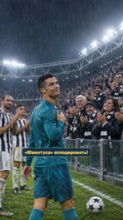
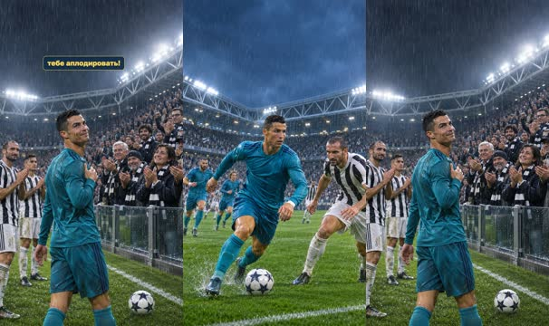
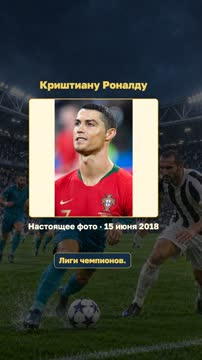
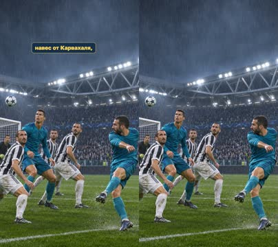
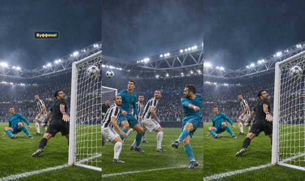
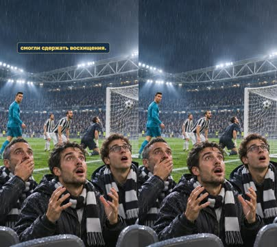
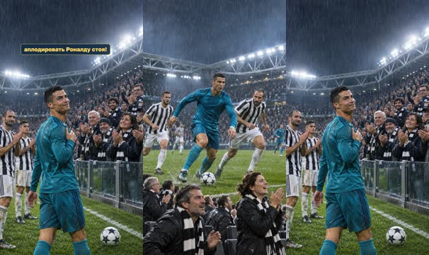
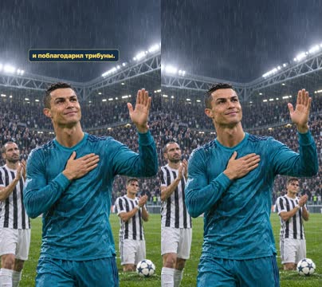
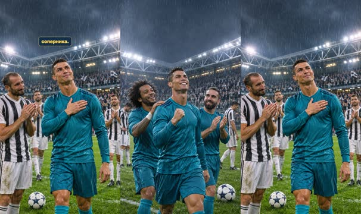

# План: Роналду — овация фанатов «Ювентуса» · V2

> Сгенерировано `storygro plan` из `ru.reel.yaml`, 2026-11-02. Не правьте этот файл: текст — в спецификации ролика, вопросы и заметки — в `review.yaml`. Затем `storygro plan` заново.

| | |
|---|---|
| Статус | **сценарий** · ждёт тебя: одобрить сценарий |
| Длительность | 66.2 с (по озвучке) · 9 сцен |
| Формат | 1080×1920, 30 fps · style `cartoon` |
| Голос | omnivoice · assets/voice/narrator-ru.wav · 0.9 |
| Серия | football-wow |

## Одобрения

| | | Кто и когда |
|---|---|---|
| Сценарий | ✏️ изменено после одобрения | agent 2026-11-02 |
| Раскадровка | ⚙️ техническое (агент) | agent 2026-11-02 |
| Выпуск | ⏳ ждёт |   |

Одобрить: `storygro approve <spec> --step script|storyboard|release` (агент — с `--agent`).

## Вопросы

- [ ] **owner** · Просмотреть V2:прыжок недоступен после повторного отказа генератора,обе диалоговые реплики удалены;полное слушание и решение о релизе остаются за владельцем.

**Заметки:** Explicit owner corrections2November2026. OriginalV1 preserved.

## Хук

- Вариант 1 · **выбран**: «Роналду благодарит аплодирующих соперников — выбранное»
- Вариант 2: «Удар через себя — генерация недоступна»
- Вариант 3: «Удивлённый болельщик начинает хлопать»

## Сцены

### 1. hook · 0.0–5.5 с · `series-cover`

кадр в ключевой момент, затем картинки сцены по порядку

**Голос:** ФУТБОЛЬНЫЙ ВАУ-ФАКТ! Роналду заставил фанатов «Ювентуса» аплодировать!

**Источник озвучки:** `assets/voice/hook.wav`

**Темп реплики:** 1

**На экране:** «Маленькие большие дела» · «ФУТБОЛЬНЫЙ ВАУ-ФАКТ!» · «Роналду · овация соперников» · «3.2»

> ⚠️ Ударение не проверено: ВАУ-ФАКТ — найти и добавить в словарь: `storygro stress <spec> --lookup --write`

**Факты:** `facts.series.project` = «Маленькие большие дела» · `facts.series.title` = «ФУТБОЛЬНЫЙ ВАУ-ФАКТ!» · `facts.series.episode` = «Роналду · овация соперников»

### 2. imagine · 5.5–16.7 с · `illustration`

кадр в ключевой момент, затем картинки сцены по порядку

**Голос:** Представьте: ты играешь на стадионе соперника, забиваешь невероятный гол… и вдруг тысячи болельщиков другой команды встают и начинают тебе аплодировать!

**Источник озвучки:** `assets/voice/imagine.wav`

**Темп реплики:** 1

**Картинки:**

- shots/arena.png — ok
- `@clap` shots/applause.png — ok

### 3. match · 16.7–25.5 с · `archive-photo`

кадр в ключевой момент, затем картинки сцены по порядку

**Голос:** 3 апреля 2018 года «Реал Мадрид» играл против «Ювентуса» в четвертьфинале Лиги чемпионов.

**Источник озвучки:** `assets/voice/match.wav`

**Темп реплики:** 1

**На экране:** «Криштиану Роналду» · «Настоящее фото · 15 июня 2018» · «contain»

**Факты:** `facts.archive.title` = «Криштиану Роналду» · `facts.archive.date` = «Настоящее фото · 15 июня 2018»

### 4. cross · 25.5–31.5 с · `illustration`

кадр в ключевой момент, затем картинки сцены по порядку

**Голос:** На 64-й минуте Криштиану Роналду получил навес от Карвахаля,

**Источник озвучки:** `assets/voice/cross.wav`

**Темп реплики:** 1

**Картинки:**

- shots/cross.png — ok

### 5. kick · 31.5–38.6 с · `illustration`

кадр в ключевой момент, затем картинки сцены по порядку

**Голос:** высоко выпрыгнул и ударил через себя, отправив мяч прямо в ворота Джанлуиджи Буффона!

**Источник озвучки:** `assets/voice/kick.wav`

**Темп реплики:** 1

**Картинки:**

- shots/cross.png — ok
- `@goal` shots/goal-v2.png — ok

### 6. wonder · 38.6–45.4 с · `illustration`

кадр в ключевой момент, затем картинки сцены по порядку

**Голос:** Гол был настолько фантастическим, что даже фанаты «Ювентуса» не смогли сдержать восхищения.

**Источник озвучки:** `assets/voice/wonder.wav`

**Темп реплики:** 1

**Картинки:**

- shots/stunned.png — ok

### 7. ovation · 45.4–50.1 с · `illustration`

кадр в ключевой момент, затем картинки сцены по порядку

**Голос:** Весь стадион начал аплодировать Роналду стоя!

**Источник озвучки:** `assets/voice/ovation.wav`

**Темп реплики:** 1

**Картинки:**

- shots/rise.png — ok
- `@standing` shots/applause.png — ok

### 8. thanks · 50.1–55.6 с · `illustration`

кадр в ключевой момент, затем картинки сцены по порядку

**Голос:** Сам Криштиану приложил руку к сердцу и поблагодарил трибуны.

**Источник озвучки:** `assets/voice/thanks.wav`

**Темп реплики:** 1

**Картинки:**

- shots/thanks.png — ok

### 9. result · 55.6–66.2 с · `illustration`

кадр в ключевой момент, затем картинки сцены по порядку

**Голос:** «Реал» выиграл матч со счётом 3:0, но этот гол запомнился не только победой — он подарил Роналду овацию от болельщиков соперника.

**Источник озвучки:** `assets/voice/result.wav`

**Темп реплики:** 1

**Картинки:**

- shots/celebrate.png — ok
- `@respect` shots/ending.png — ok

## Факты и источники

| | |
|---|---|
| `facts.series` | Owner script2026-11-02;editorial description,not nickname |
| `facts.archive` | photos.json:P1,Анна Нэсси/soccer.ru |
| `facts.story` | sources.md:S1,S2 |

→ [sources.md](sources.md)

## Текст поста

> Маленькие большие дела · ФУТБОЛЬНЫЙ ВАУ-ФАКТ! smart_little_toons.
>
> 3 апреля2018: «Ювентус»—«Реал»0:3. Гол Роналду через себя на64-й минуте и овация соперников. Источники:UEFA и Juventus, ссылки в sources.md.
>
> Художественные AI-иллюстрации созданы встроенным image_gen (точный ID модели не раскрыт), движение камеры и смена состояний; это не документальная съёмка и не полная анимация. Кадр самого удара недоступен:генерация повторно отклонена,навес сменяется результатом гола. Озвучка синтетическая:OmniVoice B.
>
> Подлинное фото:Анна Нэсси / soccer.ru,15июня2018,Португалия—Испания,не матч3апреля. https://commons.wikimedia.org/wiki/File:Cristiano_Ronaldo_2018.jpg ; CC BY-SA3.0 https://creativecommons.org/licenses/by-sa/3.0/ . Фото показано целиком,без ретуши. Фотография сохраняет собственную лицензию,другие материалы имеют отдельные условия.
