# План: Златан Ибрагимович — гол через себя почти с 30 метров!

> Сгенерировано `storygro plan` из `ru.reel.yaml`, 2026-11-02. Не правьте этот файл: текст — в спецификации ролика, вопросы и заметки — в `review.yaml`. Затем `storygro plan` заново.

| | |
|---|---|
| Статус | **сценарий** · ждёт тебя: одобрить сценарий |
| Длительность | 80.8 с (по озвучке) · 12 сцен |
| Формат | 1080×1920, 30 fps · style `cartoon` |
| Голос | omnivoice · assets/voice/narrator-ru.wav · 0.9 |
| Серия | football-wow |

## Одобрения

| | | Кто и когда |
|---|---|---|
| Сценарий | ⚙️ техническое (агент) | agent 2026-11-02 |
| Раскадровка | ⚙️ техническое (агент) | agent 2026-11-02 |
| Выпуск | ⏳ ждёт |   |

Одобрить: `storygro approve <spec> --step script|storyboard|release` (агент — с `--agent`).

## Вопросы

- [ ] **owner** · Посмотреть полный фильм:сходство Златана,рисунки,темп,ударения и выбранные голоса. Релиз ожидает решения владельца.

**Заметки:** Owner commissioned full verbatim film2026-11-02 and authorised removing ONLY UEFA.com+3. Production/render for review authorised. No owner storyboard/release approvals or publication inferred.

## Хук

- Вариант 1 · **выбран**: «Удар через себя под полной идентичностью — выбранная картинка, исходная первая фраза»
- Вариант 2: «Пустые ворота далеко за Хартом»
- Вариант 3: «Златан замечает мяч — крупный план»

## Сцены

### 1. hook · 0.0–7.2 с · `series-cover`

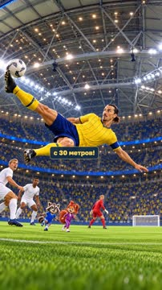

кадр в ключевой момент, затем картинки сцены по порядку

**Голос:** ФУТБОЛЬНЫЙ ВАУ-ФАКТ! Златан Ибрагимович забил невероятный гол через себя почти с 30 метров!

**Источник озвучки:** `assets/voice/hook.wav`

**Темп реплики:** 1

**На экране:** «Маленькие большие дела» · «ФУТБОЛЬНЫЙ ВАУ-ФАКТ!» · «Златан Ибрагимович · невероятный удар» · «3.2»

> ⚠️ Ударение не проверено: ВАУ-ФАКТ — найти и добавить в словарь: `storygro stress <spec> --lookup --write`

**Факты:** `facts.series.project` = «Маленькие большие дела» · `facts.series.title` = «ФУТБОЛЬНЫЙ ВАУ-ФАКТ!» · `facts.series.episode` = «Златан Ибрагимович · невероятный удар»

### 2. arena · 7.2–21.1 с · `illustration`

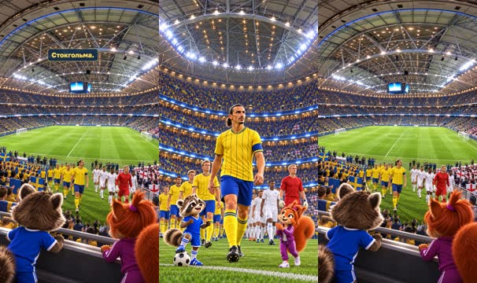

кадр в ключевой момент, затем картинки сцены по порядку

**Голос:** 14 ноября 2012 года сборная Швеции принимала Англию в товарищеском матче на открытии нового национального стадиона Friends Arena в городе Сольна, недалеко от Стокгольма.

**Источник озвучки:** `assets/voice/arena.wav`

**Темп реплики:** 1

**Картинки:**

- shots/arrival-safe.png — ok
- `@venue` shots/arena-wide.png — ok

> ⚠️ Ударение не проверено: Англию, Арена, Сольна — найти и добавить в словарь: `storygro stress <spec> --lookup --write`

### 3. crowd · 21.1–25.3 с · `illustration`

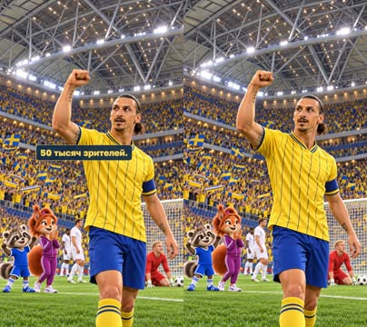

кадр в ключевой момент, затем картинки сцены по порядку

**Голос:** На трибунах собрались почти 50 тысяч зрителей.

**Источник озвучки:** `assets/voice/crowd.wav`

**Темп реплики:** 1

**Картинки:**

- shots/crowd.png — ok

### 4. england · 25.3–31.1 с · `illustration`

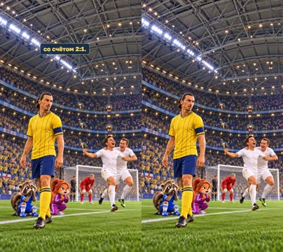

кадр в ключевой момент, затем картинки сцены по порядку

**Голос:** Матч получился напряжённым: Англия даже вышла вперёд со счётом 2:1.

**Источник озвучки:** `assets/voice/england.wav`

**Темп реплики:** 1

**Картинки:**

- shots/england-safe.png — ok

**На слух:** вперёд — верно (дубль 1)

### 5. four · 31.1–36.8 с · `illustration`

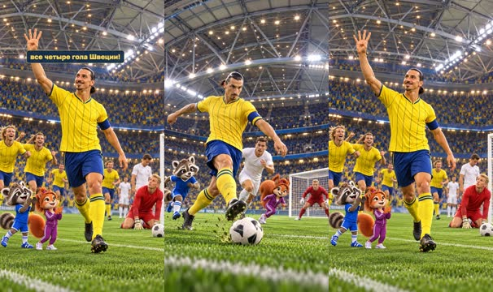

кадр в ключевой момент, затем картинки сцены по порядку

**Голос:** Но Златан Ибрагимович устроил настоящее шоу и забил все четыре гола Швеции!

**Источник озвучки:** `assets/voice/four.wav`

**Темп реплики:** 1

**Картинки:**

- shots/strike.png — ok
- `@four` shots/celebrate.png — ok

### 6. hart · 36.8–45.3 с · `illustration`

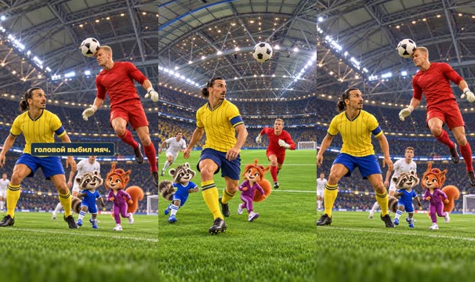

кадр в ключевой момент, затем картинки сцены по порядку

**Голос:** А теперь самое невероятное. На последних минутах английский вратарь Джо Харт вышел далеко из ворот и головой выбил мяч.

**Источник озвучки:** `assets/voice/hart.wav`

**Темп реплики:** 1

**Картинки:**

- shots/hart-run.png — ok
- `@header` shots/header.png — ok

### 7. bicycle · 45.3–52.6 с · `illustration`

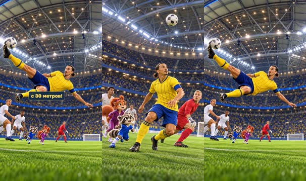

кадр в ключевой момент, затем картинки сцены по порядку

**Голос:** Златан оказался рядом, развернулся спиной к воротам и пробил через себя примерно с 30 метров!

**Источник озвучки:** `assets/voice/bicycle.wav`

**Темп реплики:** 1

**Картинки:**

- shots/turn.png — ok
- `@kick` shots/bicycle-correct.png — ok

### 8. net · 52.6–57.2 с · `illustration`

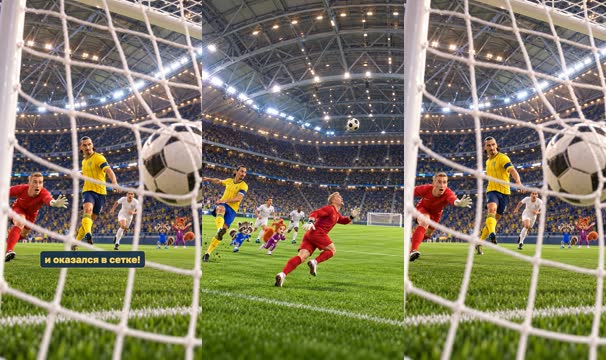

кадр в ключевой момент, затем картинки сцены по порядку

**Голос:** Мяч перелетел через вратаря и оказался в сетке!

**Источник озвучки:** `assets/voice/net.wav`

**Темп реплики:** 1

**Картинки:**

- shots/flight.png — ok
- `@net` shots/net.png — ok

### 9. result · 57.2–64.6 с · `archive-photo`

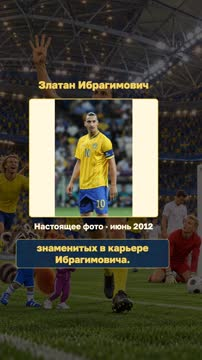

кадр в ключевой момент, затем картинки сцены по порядку

**Голос:** Швеция победила со счётом 4:2, а этот гол стал одним из самых знаменитых в карьере Ибрагимовича.

**Источник озвучки:** `assets/voice/result.wav`

**Темп реплики:** 1

**На экране:** «Златан Ибрагимович» · «Настоящее фото · июнь 2012» · «contain»

> ⚠️ Ударение не проверено: Ибрагимовича — найти и добавить в словарь: `storygro stress <spec> --lookup --write`

**Факты:** `facts.archive.title` = «Златан Ибрагимович» · `facts.archive.date` = «Настоящее фото · июнь 2012»

### 10. award · 64.6–71.0 с · `illustration`

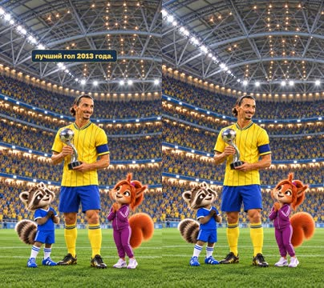

кадр в ключевой момент, затем картинки сцены по порядку

**Голос:** Позже он получил премию ФИФА имени Пушкаша за лучший гол 2013 года.

**Источник озвучки:** `assets/voice/award.wav`

**Темп реплики:** 1

**Картинки:**

- shots/award-safe.png — ok

> ⚠️ Ударение не проверено: ФИФА — найти и добавить в словарь: `storygro stress <spec> --lookup --write`

### 11. matvey · 71.0–75.4 с · `illustration`

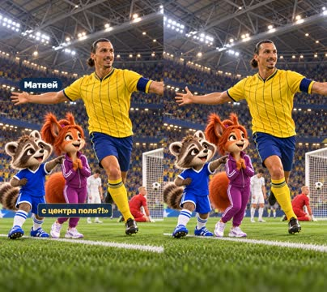

кадр в ключевой момент, затем картинки сцены по порядку

**Голос:** Матвей: «Он что, решил забить гол через себя почти с центра поля?!»

**Источник озвучки:** `assets/voice/matvey.wav`

**Темп реплики:** 1

**На экране:** «Матвей»

**Картинки:**

- shots/matvey.png — ok

**Факты:** `facts.cast.matvey` = «Матвей»

### 12. sofia · 75.4–80.8 с · `illustration`

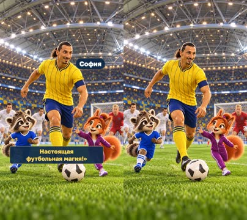

кадр в ключевой момент, затем картинки сцены по порядку

**Голос:** София: «И ведь получилось! Настоящая футбольная магия!»

**Источник озвучки:** `assets/voice/sofia.wav`

**Темп реплики:** 1

**На экране:** «София»

**Картинки:**

- shots/sofia.png — ok

**Факты:** `facts.cast.sofia` = «София»

## Факты и источники

| | |
|---|---|
| `facts.series` | Owner verbatim script,2026-11-02; editorial trait,not historical nickname |
| `facts.archive` | photos.json:Football.ua,Euro2012;file date ambiguity disclosed |
| `facts.cast` | ../../series/football-legends/cast/cast.json |
| `facts.story` | sources.md:S1,S2,S3;score order explicitly team-bound |

→ [sources.md](sources.md)

## Текст поста

> Маленькие большие дела · ФУТБОЛЬНЫЙ ВАУ-ФАКТ! smart_little_toons, София и Матвей.
>
> 14 ноября 2012, Швеция — Англия, Friends Arena: четыре гола Златана и знаменитый удар через себя. Премия Пушкаша2013 присуждена за гол2012; церемония13 января2014. Источники: UEFA, Svensk Fotboll, FIFA, Puskas.com.
>
> Рисунки созданы встроенным image_gen (точный ID модели не раскрыт); оригинальная художественная интерпретация,не архивное видео. Голоса синтетические: OmniVoice B, выбранные Матвей C и София A через Qwen3-TTS.
>
> Настоящее фото: Илья Хохлов / Football.ua, июнь2012, CC BY-SA3.0, https://commons.wikimedia.org/wiki/File:Zlatan_Ibrahimovi%C4%87_Euro_2012_vs_England.JPG ; https://creativecommons.org/licenses/by-sa/3.0/ . Фото сохранено без ретуши и показано целиком. Это Евро2012,не ноябрьский гол. Архитектурный референс: Richard Matthews, Friends Arena14.11.2012,CC BY2.0, https://commons.wikimedia.org/wiki/File:Friends_Arena,_Stockholm.jpg . Сам снимок арены в фильм не включён. Отдельные условия сторонних материалов сохраняются.
