# План: Обзор матчей · Ливерпуль — Арсенал · 01.11.2026 · V2

> Сгенерировано `storygro plan` из `ru.reel.yaml`, 2026-11-02. Не правьте этот файл: текст — в спецификации ролика, вопросы и заметки — в `review.yaml`. Затем `storygro plan` заново.

| | |
|---|---|
| Статус | **сценарий** · ждёт тебя: одобрить сценарий |
| Длительность | 79.7 с (по озвучке) · 13 сцен |
| Формат | 1080×1920, 30 fps · style `cartoon` |
| Голос | omnivoice · assets/voice/narrator-ru.wav · 0.9 |
| Серия | match-review |

## Одобрения

| | | Кто и когда |
|---|---|---|
| Сценарий | ⏳ ждёт |   |
| Раскадровка | ⚙️ техническое (агент) | agent 2026-11-02 |
| Выпуск | ⏳ ждёт |   |

Одобрить: `storygro approve <spec> --step script|storyboard|release` (агент — с `--agent`).

## Вопросы

- [ ] **owner** · Просмотреть исправленную версию: София жёлто-тёмно-синяя/Арсенал, Матвей красный/Ливерпуль. Новая реплика: «Я за Ливерпуль… Как же мы пропустили?» Полный просмотр/слушание и решение о релизе владельцу.

**Заметки:** Owner requested distinguishable club clothes and questioned unclear opening. Technical render only;no owner approval inferred;no publication.

## Хук

- Вариант 1 · **выбран**: «София празднует, Матвей не верит: один гол завершил 14 лет ожидания — выбранное»
- Вариант 2: «Перекладина Вирца и противоположные реакции друзей»
- Вариант 3: «Как одного гола хватило, чтобы покорить Энфилд?»

## Сцены

### 1. hook · 0.0–7.0 с · `series-cover`

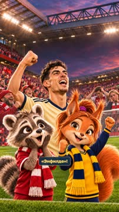

кадр в ключевой момент, затем картинки сцены по порядку

**Голос:** Обзор матчей! 14 лет ожидания — и наконец-то «Арсенал» снова побеждает на «Энфилде»!

**Источник озвучки:** `assets/voice/hook.wav`

**Темп реплики:** 1

**На экране:** «Маленькие большие дела» · «ОБЗОР МАТЧЕЙ» · «Ливерпуль — Арсенал · 01.11.2026» · «4.4»

> ⚠️ Ударение не проверено: Энфилде — найти и добавить в словарь: `storygro stress <spec> --lookup --write`

**Факты:** `facts.series.project` = «Маленькие большие дела» · `facts.series.title` = «ОБЗОР МАТЧЕЙ» · `facts.series.episode` = «Ливерпуль — Арсенал · 01.11.2026»

### 2. rivalry · 7.0–11.2 с · `illustration`

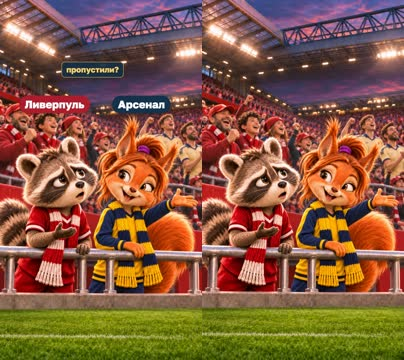

кадр в ключевой момент, затем картинки сцены по порядку

**Голос:** Я за «Ливерпуль»… Как же мы пропустили?

**Источник озвучки:** `assets/voice/rivalry.wav`

**Темп реплики:** 1

**На экране:** «Ливерпуль» · «Арсенал»

**Картинки:**

- shots/rivalry-v2-contrast-question.png — ok

**Факты:** `facts.supporters.matvey` = «Ливерпуль» · `facts.supporters.sofia` = «Арсенал»

### 3. goal · 11.2–21.0 с · `illustration`

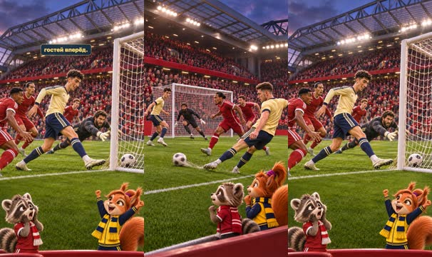

кадр в ключевой момент, затем картинки сцены по порядку

**Голос:** Единственный гол встречи был забит на 16-й минуте: Кай Хаверц отправил мяч в ворота «Ливерпуля» и вывел гостей вперёд.

**Источник озвучки:** `assets/voice/goal.wav`

**Темп реплики:** 1

**Картинки:**

- shots/cross-contrast.png — ok
- `@finish` shots/goal-contrast.png — ok

**На слух:** вперёд — верно (дубль 1)

### 4. sofia-goal · 21.0–25.3 с · `archive-photo`

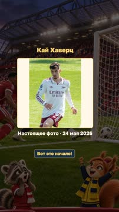

кадр в ключевой момент, затем картинки сцены по порядку

**Голос:** Райс прострелил — Хаверц замкнул! Вот это начало!

**Источник озвучки:** `assets/voice/sofia-goal.wav`

**Темп реплики:** 1

**На экране:** «Кай Хаверц» · «Настоящее фото · 24 мая 2026» · «contain»

**Факты:** `facts.archive.title` = «Кай Хаверц» · `facts.archive.date` = «Настоящее фото · 24 мая 2026»

### 5. pressure · 25.3–35.2 с · `illustration`

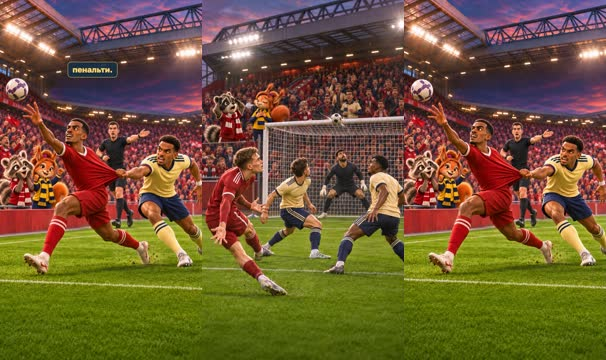

кадр в ключевой момент, затем картинки сцены по порядку

**Голос:** Хозяева пытались спасти матч. Флориан Вирц попал в перекладину, были опасные моменты и споры вокруг возможного пенальти.

**Источник озвучки:** `assets/voice/pressure.wav`

**Темп реплики:** 1

**Картинки:**

- shots/bar-v2-contrast.png — ok
- `@appeal` shots/penalty-v2-contrast.png — ok

### 6. penalty · 35.2–40.4 с · `illustration`

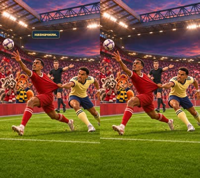

кадр в ключевой момент, затем картинки сцены по порядку

**Голос:** Тимбер тянул Исака за футболку! Но пенальти не назначили.

**Источник озвучки:** `assets/voice/penalty.wav`

**Темп реплики:** 1

**Картинки:**

- shots/penalty-v2-contrast.png — ok

> ⚠️ Ударение не проверено: Исака — найти и добавить в словарь: `storygro stress <spec> --lookup --write`

### 7. changes · 40.4–48.2 с · `illustration`

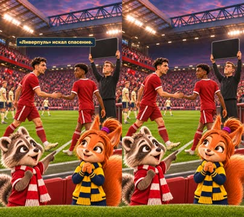

кадр в ключевой момент, затем картинки сцены по порядку

**Голос:** После травмы вернулся Собослаи, сменив Ньони. Вместо Гакпо вышел Нгумоа. «Ливерпуль» искал спасение.

**Источник озвучки:** `assets/voice/changes.wav`

**Темп реплики:** 1

**Картинки:**

- shots/changes-v2-contrast.png — ok

> ⚠️ Ударение не проверено: Собослаи, Гакпо, Нгумоа — найти и добавить в словарь: `storygro stress <spec> --lookup --write`

### 8. save · 48.2–53.7 с · `illustration`

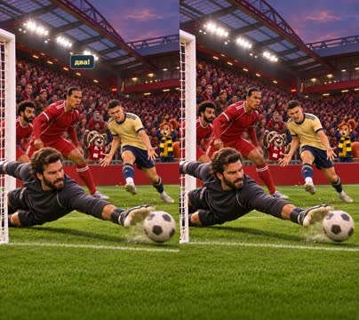

кадр в ключевой момент, затем картинки сцены по порядку

**Голос:** Алиссон спас после удара Цолиса! Могло быть и два!

**Источник озвучки:** `assets/voice/save.wav`

**Темп реплики:** 1

**Картинки:**

- shots/save-contrast.png — ok

### 9. cards · 53.7–58.5 с · `illustration`

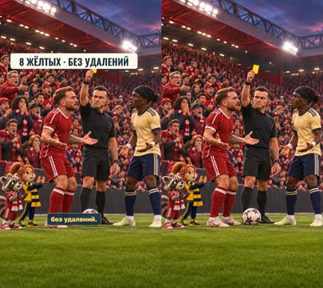

кадр в ключевой момент, затем картинки сцены по порядку

**Голос:** Напряжение росло: восемь жёлтых карточек, без удалений.

**Источник озвучки:** `assets/voice/cards.wav`

**Темп реплики:** 1

**На экране:** «8 жёлтых · без удалений»

**Картинки:**

- shots/cards-contrast.png — ok

**Факты:** `facts.cards.title` = «8 жёлтых · без удалений»

### 10. defence · 58.5–63.0 с · `illustration`

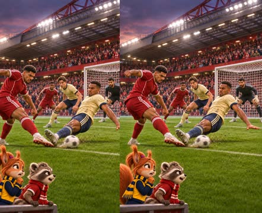

кадр в ключевой момент, затем картинки сцены по порядку

**Голос:** Но оборона «Арсенала» выдержала давление.

**Источник озвучки:** `assets/voice/defence.wav`

**Темп реплики:** 1

**Картинки:**

- shots/defence-contrast.png — ok

> ⚠️ Ударение не проверено: Арсенала — найти и добавить в словарь: `storygro stress <spec> --lookup --write`

### 11. result · 63.0–72.2 с · `illustration`

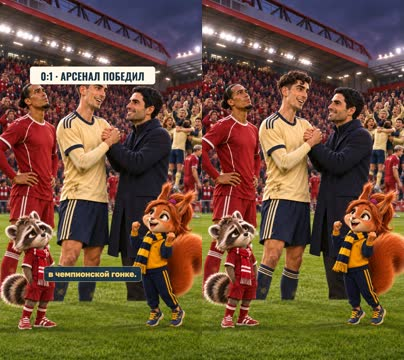

кадр в ключевой момент, затем картинки сцены по порядку

**Голос:** Итог — 0:1! Команда Микеля Артеты увозит три очка из Ливерпуля и укрепляет свои позиции в чемпионской гонке.

**Источник озвучки:** `assets/voice/result.wav`

**Темп реплики:** 1

**На экране:** «0:1 · Арсенал победил»

**Картинки:**

- shots/result-contrast.png — ok

> ⚠️ Ударение не проверено: Микеля, Артеты — найти и добавить в словарь: `storygro stress <spec> --lookup --write`

**Факты:** `facts.result.display` = «0:1 · Арсенал победил»

### 12. respect · 72.2–75.6 с · `illustration`

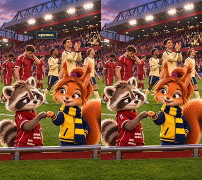

кадр в ключевой момент, затем картинки сцены по порядку

**Голос:** Обидно! Но выстояли вы крепко.

**Источник озвучки:** `assets/voice/respect.wav`

**Темп реплики:** 1

**Картинки:**

- shots/ending-contrast.png — ok

### 13. ending · 75.6–79.7 с · `illustration`

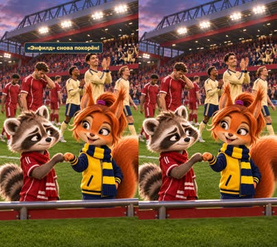

кадр в ключевой момент, затем картинки сцены по порядку

**Голос:** «Энфилд» снова покорён!

**Источник озвучки:** `assets/voice/ending.wav`

**Темп реплики:** 1

**Картинки:**

- shots/ending-contrast.png — ok

## Факты и источники

| | |
|---|---|
| `facts.series` | Owner brief2026-11-02;S1,S2:match date and home/away order |
| `facts.archive` | photos.json:P1,Chensiyuan/NullReason |
| `facts.goal` | S1,S2: Havertz 16, Rice low cross |
| `facts.changes` | S1: substitutions; minute58/59 discrepancy deliberately omitted |
| `facts.cards` | S3:4yellow cards each,0red;S4cross-check |
| `facts.penalty` | S2:Timber shirt pull on Isak, officials did not award penalty |
| `facts.result` | Owner text;S2:first Anfield win14years |
| `facts.events` | S1,S2,S3,S4; all events research record, only story-relevant subset in film |
| `facts.supporters` | Owner rubric brief and review correction2026-11-02;episode-specific roles |

→ [sources.md](sources.md)

## Текст поста

> Маленькие большие дела · ОБЗОР МАТЧЕЙ. Новый выпуск smart_little_toons: София за «Арсенал», Матвей за «Ливерпуль». Разные команды, одна любовь к футболу!
>
> Ливерпуль — Арсенал, 1 ноября 2026: 0:1, Хаверц, 16-я минута. Гол, перекладина Вирца, спорный эпизод без назначенного пенальти, замены, сейв Алиссона и нервный финал. Источники: Liverpool FC и Sky Sports, ссылки в sources.md.
>
> Подробные художественные AI-иллюстрации созданы встроенным image_gen, точный ID модели инструмент не раскрывает. Смена нарисованных состояний и движение камеры; не документальная видеозапись и не полная анимация персонажей. Реакции Софии и Матвея — авторские. Озвучка синтетическая: OmniVoice B, Qwen3 с точными выбранными голосами София A/Матвей C.
>
> Настоящее фото Кая Хаверца: Chensiyuan, 24 мая 2026; кадрирование NullReason, CC BY-SA 4.0 https://creativecommons.org/licenses/by-sa/4.0/ . https://commons.wikimedia.org/wiki/File:1_kai_havertz_2026_(cropped).jpg . Использован существующий опубликованный кроп, показан целиком, без ретуши; это не фото матча 1 ноября. Фото сохраняет свою лицензию; остальные материалы имеют отдельные условия.
>
> Исправленная версия: София в жёлто-тёмно-синих цветах Арсенала, Матвей в красных цветах Ливерпуля. Вступительная реплика Матвея объясняет переход к сцене гола.
